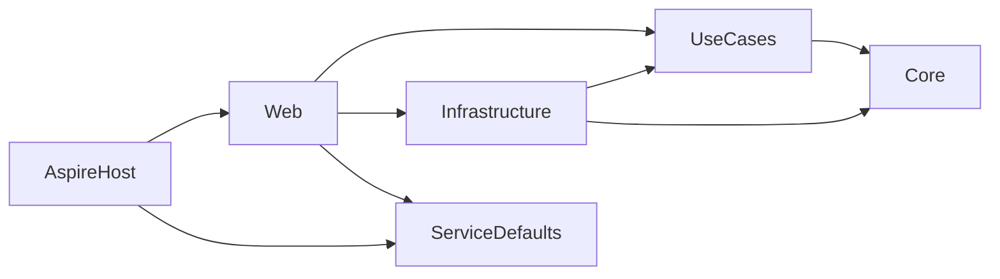

# Clean Architecture Template (`clean-arch`)

```bash
dotnet new install Ardalis.CleanArchitecture.Template
dotnet new clean-arch -o Your.ProjectName
```

The full template generates a multi-project solution where each layer is its own project, so the compiler enforces which layers may depend on which.

## Solution structure

```text
Your.ProjectName/
├── src/
│   ├── Your.ProjectName.Core/             Domain model: aggregates, value objects, events, specifications, interfaces
│   ├── Your.ProjectName.UseCases/         Application layer: commands, queries, and their handlers (CQRS)
│   ├── Your.ProjectName.Infrastructure/   EF Core, repositories, query services, email
│   ├── Your.ProjectName.Web/              ASP.NET Core host: FastEndpoints API, DI and middleware configuration
│   ├── Your.ProjectName.AspireHost/       .NET Aspire app host: SQL Server and Papercut SMTP containers
│   └── Your.ProjectName.ServiceDefaults/  Aspire service defaults: OpenTelemetry, health checks, resilience
├── tests/
│   ├── Your.ProjectName.UnitTests/
│   ├── Your.ProjectName.IntegrationTests/
│   ├── Your.ProjectName.FunctionalTests/
│   └── Your.ProjectName.AspireTests/      Placeholder for Aspire tests (not in the .slnx by default)
├── Directory.Build.props                  Target framework, nullable, warnings as errors, Central Package Management
├── Directory.Packages.props               Every NuGet package version, in one place
├── global.json                            .NET SDK version
├── nuget.config                           Package sources (nuget.org)
├── .runsettings                           Parallel test execution settings
└── Your.ProjectName.slnx
```

## Project dependencies

Dependencies point inward, toward Core. Core depends on no other project in the solution.



Infrastructure implements abstractions defined by the inner layers: `IEmailSender` (Core), `IListContributorsQueryService` (UseCases), and the `IRepository<T>` and `IReadRepository<T>` interfaces from Ardalis.SharedKernel (implemented by `EfRepository<T>`). The Web project wires those implementations up with dependency injection at startup. That's the only reason it references Infrastructure.

## The projects

### Core

The center of the architecture: the domain model and business rules. It has very few external dependencies (Ardalis.SharedKernel, GuardClauses, Result, SmartEnum, Specification, Vogen, and Mediator abstractions for domain events).

The template's example aggregate lives in `ContributorAggregate/`:

| File | Pattern |
|---|---|
| `Contributor.cs` | Aggregate root entity with encapsulated state and behavior (`UpdateName`, `UpdatePhoneNumber`) |
| `ContributorId.cs`, `ContributorName.cs` | Strongly typed ID and value object generated by [Vogen](https://github.com/SteveDunn/Vogen), with validation |
| `ContributorStatus.cs` | [SmartEnum](https://github.com/ardalis/SmartEnum) |
| `PhoneNumber.cs` | Multi-property value object (`ValueObject` base class) |
| `Events/`, `Handlers/` | Domain events (`ContributorNameUpdatedEvent`, `ContributorDeletedEvent`) and their handlers |
| `Specifications/` | [Ardalis.Specification](https://github.com/ardalis/Specification) query specifications |

`Interfaces/` holds abstractions implemented elsewhere (`IEmailSender`, `IDeleteContributorService`), and `Services/` holds domain services such as `DeleteContributorService`.

### UseCases

The application layer, also called *Application Services*. It's organized by feature, then by command or query: `Contributors/Create`, `Contributors/Update`, `Contributors/Delete`, `Contributors/GetById`, and `Contributors/List`. Each folder holds a command or query record and its [Mediator](https://github.com/martinothamar/Mediator) handler.

- **Commands** mutate state and use repository abstractions to load and save aggregates.
- **Queries** are read-only and don't need the repository pattern. `ListContributorsQuery` uses an `IListContributorsQueryService` that Infrastructure implements with a direct query.

The project is optional. Without it, endpoints would work directly with the domain model and query services. It's included because many teams want it, and it's easier to remove than to add later. It gives you a UI-ignorant place for tests and for cross-cutting pipeline behaviors (the template registers a `LoggingBehavior` from Ardalis.SharedKernel).

### Infrastructure

Everything that talks to the outside world, implementing interfaces from Core and UseCases:

- `Data/AppDbContext.cs`, `EfRepository.cs`, entity configurations in `Data/Config/`, and EF Core migrations in `Data/Migrations/`
- `Data/EventDispatcherInterceptor.cs`: an EF Core `SaveChanges` interceptor that dispatches domain events after changes are saved
- `Data/Queries/`: query service implementations used by UseCases queries
- `Data/SeedData.cs`: seeds sample contributors in Development
- `Email/MimeKitEmailSender.cs` (SMTP via MailKit) and `Email/FakeEmailSender.cs`
- `InfrastructureServiceExtensions.cs`: the `AddInfrastructureServices()` extension method that registers all of the above and [selects the database provider](../running.md#how-the-database-is-chosen)

For a large app you might split this into several projects (`Infrastructure.Data`, `Infrastructure.Messaging`, ...), but one project with folders works for most.

### Web

The ASP.NET Core entry point. API endpoints use [FastEndpoints](https://fast-endpoints.com/) and the [REPR pattern](https://deviq.com/design-patterns/repr-design-pattern) (Request, Endpoint, Response), one endpoint per class:

```text
Contributors/
├── Create.cs                               POST /Contributors
├── GetById.cs                              GET /Contributors/{id}
├── List.cs                                 GET /Contributors
├── Update.cs                               PUT /Contributors/{id}
├── Delete.cs                               DELETE /Contributors/{id}
├── Update.UpdateContributorRequest.cs      Request, response, and validator types
├── Update.UpdateContributorValidator.cs    can live in their own files...
└── ...
```

`Create.cs` shows the alternative of keeping an endpoint's request, response, and validator types in one file. Separate files mean more files but fewer merge conflicts.

Startup is split into small extension methods under `Configurations/` so that `Program.cs` stays short: `LoggerConfigs`, `OptionConfigs`, `ServiceConfigs`, `MediatorConfig`, and `MiddlewareConfig`. The project also includes an `api.http` file for trying the endpoints from Visual Studio or VS Code.

### AspireHost and ServiceDefaults

`AspireHost` is a [.NET Aspire](https://learn.microsoft.com/dotnet/aspire/) app host that starts a persistent SQL Server container, creates the `cleanarchitecture` database, starts a Papercut SMTP container, and runs the Web project with the connection string injected. `ServiceDefaults` adds OpenTelemetry (logs, metrics, traces), health checks, service discovery, and HTTP resilience to the Web project. See [Running the Application](../running.md).

### Test projects

| Project | What it tests |
|---|---|
| `UnitTests` | Core and UseCases in isolation, using [NSubstitute](https://nsubstitute.github.io/) for test doubles |
| `IntegrationTests` | `EfRepository` against EF Core's in-memory provider and in-memory SQLite |
| `FunctionalTests` | The HTTP API end to end with `WebApplicationFactory`, against SQL Server in a [Testcontainers](https://testcontainers.com/) container, or SQLite when Docker isn't available |
| `AspireTests` | Empty placeholder for [Aspire integration tests](https://learn.microsoft.com/dotnet/aspire/testing/write-your-first-test) |

All test projects use xUnit v3 and [Shouldly](https://docs.shouldly.org/). See [Building & Testing](../testing.md).

## Key dependencies

| Area | Packages |
|---|---|
| API | FastEndpoints, FastEndpoints.Swagger, Scalar.AspNetCore, Ardalis.Result.AspNetCore |
| Application | Mediator.Abstractions, Mediator.SourceGenerator, Ardalis.Result |
| Domain | Ardalis.SharedKernel, Ardalis.GuardClauses, Ardalis.SmartEnum, Ardalis.Specification, Vogen |
| Data | Microsoft.EntityFrameworkCore.SqlServer / .Sqlite, Ardalis.Specification.EntityFrameworkCore |
| Email | MailKit |
| Observability | Serilog.AspNetCore, OpenTelemetry.* (ServiceDefaults) |
| Hosting | Aspire.AppHost.Sdk, Aspire.Hosting.SqlServer |
| Testing | xunit.v3, Shouldly, NSubstitute, Testcontainers.MsSql, Microsoft.AspNetCore.Mvc.Testing, Ardalis.HttpClientTestExtensions, coverlet.collector |

Exact versions are in `Directory.Packages.props`. For why each one was chosen, see [Goals & Design Decisions](../design-decisions.md).

## The sample application

The repository's [`sample`](https://github.com/ardalis/CleanArchitecture/tree/main/sample) folder contains **NimblePros.SampleToDo**, a larger application (projects, to-do items, and contributors) built with the same architecture. It shows patterns the template only hints at. It's excluded from the template package, so clone or browse the repository to see it.
