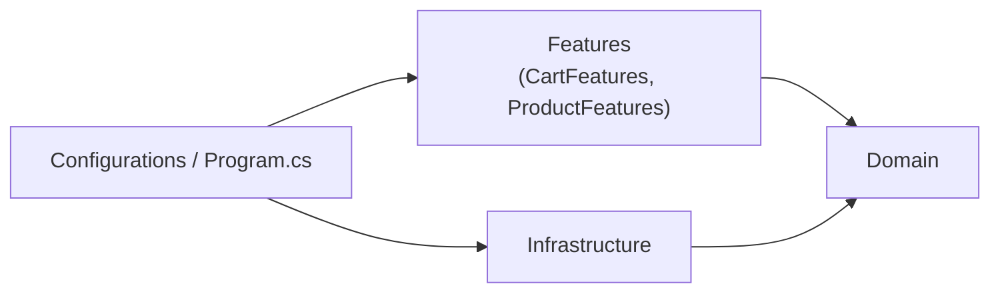

# Minimal Clean Architecture Template (`min-clean`)

```bash
dotnet new install Ardalis.MinimalClean.Template
dotnet new min-clean -o Your.ProjectName
```

## Overview

The **Minimal Clean Architecture** template takes a simplified, pragmatic approach to Clean Architecture for ASP.NET Core applications. It keeps the core principles (separation of concerns, dependency inversion, and testability) while reducing complexity by putting the application in a single project organized into vertical slices (Vertical Slice Architecture, or VSA).

## Philosophy

### Core principles

1. **Simplicity first**: minimize unnecessary abstractions and project boundaries
2. **Vertical slices**: organize by feature rather than by technical layer
3. **Pragmatic DDD**: use domain patterns where they add value, not everywhere
4. **Progressive enhancement**: start simple, and add complexity only when it's needed

### Clean Architecture principles it keeps

- ✅ **Dependency inversion**: the domain doesn't depend on infrastructure
- ✅ **Testability**: business logic can be tested in isolation
- ✅ **Separation of concerns**: clear boundaries between domain, features, and infrastructure
- ✅ **Framework independence**: domain logic isn't coupled to ASP.NET Core

### What it simplifies compared to the full template

- **Single project**: application code lives in one Web project instead of four or more
- **Fewer patterns**: essential DDD patterns (aggregates, strongly typed IDs, a few value objects, specifications), without the full catalog
- **Colocated use cases**: each feature folder holds its endpoint *and* its Mediator command or query handler; simple endpoints can skip Mediator entirely
- **Vertical organization**: group by feature (products, cart) instead of by layer
- **No test projects**: add the ones you need (see [Testing strategy](#testing-strategy))

## Solution structure

```text
Your.ProjectName/
├── src/
│   ├── Your.ProjectName.Web/
│   │   ├── Domain/                      Domain layer
│   │   │   ├── CartAggregate/           Cart (aggregate root), CartItem, CartId, specifications
│   │   │   ├── GuestUserAggregate/
│   │   │   ├── OrderAggregate/          Order, OrderItem, Price and Quantity value objects
│   │   │   ├── ProductAggregate/
│   │   │   └── Interfaces/              IEmailSender
│   │   ├── CartFeatures/                Vertical slices for the cart
│   │   │   ├── AddToCart/               AddToCartEndpoint + AddToCartHandler (command)
│   │   │   ├── Checkout/
│   │   │   ├── GetById/
│   │   │   ├── CartDto.cs
│   │   │   └── CartResponse.cs
│   │   ├── ProductFeatures/
│   │   │   ├── Create/
│   │   │   ├── GetById/
│   │   │   └── List/                    Endpoint, handler, and IListProductsQueryService
│   │   ├── Infrastructure/              Infrastructure layer
│   │   │   ├── Data/                    AppDbContext, EfRepository, Config/, Migrations/, Queries/, SeedData
│   │   │   └── Email/                   MimeKitEmailSender, FakeEmailSender
│   │   ├── Configurations/              Logger, Mediator, middleware, options, and service registration
│   │   ├── config.nsdepcop              Namespace dependency rules, checked at build time
│   │   └── Program.cs
│   ├── Your.ProjectName.AspireHost/     .NET Aspire app host (SQL Server + Papercut SMTP containers)
│   └── Your.ProjectName.ServiceDefaults/
├── Directory.Build.props
├── Directory.Packages.props
├── global.json
└── Your.ProjectName.slnx
```

### Vertical slice organization

Each feature folder (`CartFeatures`, `ProductFeatures`) contains one sub-folder per use case. A use-case folder holds everything for that operation: the FastEndpoints endpoint with its request type and validator, and the Mediator command or query with its handler. The domain types the feature works with live in `Domain/`, and the EF Core mappings for them live in `Infrastructure/Data/Config/`.

This keeps related code together, which makes features easier to understand and change independently.

### Dependency flow and enforcement



- Features use the domain and the abstractions it defines (repositories, specifications, `IEmailSender`)
- Feature slices don't depend on each other. Anything they share belongs in the domain.
- Infrastructure depends on the domain (entity configurations and interface implementations)
- The domain depends on nothing else in the project

Because everything is in one project, the compiler can't enforce these boundaries the way project references do. Instead, the template uses the [NsDepCop](https://github.com/realvizu/NsDepCop) analyzer with rules in `config.nsdepcop`. Any violation fails the build with error `NSDEPCOP01`. In short:

- `Domain` may not depend on `Infrastructure`, either feature folder, or `Configurations`
- `CartFeatures` and `ProductFeatures` may not depend on `Infrastructure` or on each other
- The `Order` aggregate may not depend on the `Cart` aggregate

Rules only cover code in these namespaces, so keep new types in namespaces that match their folders. See [Enforcing Dependency Rules](../dependency-rules.md) for every rule, the reasons behind them, and how to add rules for new features.

## Running it

The minimal template uses **SQL Server** only.

- **With Aspire (recommended)**: `dotnet run --project src/Your.ProjectName.AspireHost`. Aspire starts a persistent SQL Server container and creates the `AppDb` database, plus a Papercut SMTP container for email.
- **Without Aspire**: `dotnet run --project src/Your.ProjectName.Web` uses the `AppDb` connection string in `appsettings.json`, which points to SQL Server LocalDB (Windows). Change it to point to any SQL Server you have.

The Web project applies pending EF Core migrations and seeds sample products at startup. API docs are at `https://localhost:57379/scalar` in Development. See [Running the Application](../running.md) and [Data & Migrations](../data-and-migrations.md#minimal-clean-template) for details.

## Design decisions

### Decision 1: single project architecture

**Status**: Accepted

**Context**: The template needs to balance architectural guidance with simplicity for smaller applications.

**Decision**: Use a single Web project with a clear folder and namespace structure instead of multiple projects.

**Consequences**:
- ✅ Simpler to navigate and understand
- ✅ Faster builds (no project-to-project references)
- ✅ Easier to refactor (no project boundary concerns)
- ✅ Lower initial complexity
- ⚠️ Boundaries come from namespaces, not projects. [NsDepCop rules](../dependency-rules.md) catch violations at build time, but only for the rules you write, and only when namespaces match folders.

**Migration path**: Can be extracted into multiple projects later if needed.

### Decision 2: vertical slice organization

**Status**: Accepted

**Context**: Code should be organized in a way that's easy to understand and modify.

**Decision**: Organize by feature (vertical slices) rather than by layer (horizontal).

**Consequences**:
- ✅ Related code is colocated (easier to find)
- ✅ Features can be modified independently
- ✅ Natural fit for later extraction into separate services
- ✅ Aligns with business capabilities
- ⚠️ May have some code duplication across features
- ⚠️ Shared concerns need careful consideration

### Decision 3: pragmatic DDD

**Status**: Accepted

**Context**: Full DDD patterns can be overkill for simpler domains.

**Decision**: Use essential DDD patterns, but keep it simple.

**Patterns included**:
- ✅ Entities with encapsulation and aggregate roots
- ✅ Strongly typed IDs (Vogen)
- ✅ Value objects where they add value (`Price`, `Quantity`)
- ✅ Specifications for reusable queries

**Patterns simplified or optional**:
- ⚠️ Domain events (supported by the infrastructure, but the example domain doesn't need them)
- ⚠️ Domain services (add only when needed)

**Consequences**:
- ✅ Easier to learn and apply
- ✅ Less boilerplate code
- ✅ Faster development
- ⚠️ May need to add patterns as domain complexity grows

### Decision 4: optional Mediator/CQRS

**Status**: Accepted

**Context**: CQRS with a mediator adds valuable patterns but also complexity.

**Decision**: The template's features use Mediator commands and queries, colocated with their endpoints, but Mediator is optional. Simple endpoints can work with repositories directly. The trade-off is that logic outside Mediator handlers doesn't go through the pipeline behaviors used for cross-cutting concerns (the template registers a `LoggingBehavior`).

**Usage guidelines**:
- Simple CRUD: logic can go directly in endpoints
- Complex workflows: use Mediator commands and queries
- Cross-cutting concerns: use Mediator pipeline behaviors

**Consequences**:
- ✅ Lower initial complexity
- ✅ Developers choose the appropriate level of abstraction
- ⚠️ Inconsistent patterns across the codebase are possible
- ⚠️ Teams need clear guidelines on when to use Mediator

### Decision 5: FastEndpoints for APIs

**Status**: Accepted

**Context**: The API endpoints need to be clean and testable.

**Decision**: Use FastEndpoints with the REPR pattern.

**Consequences**:
- ✅ One class per endpoint (easy to find)
- ✅ Built-in validation support
- ✅ Clear request/response types
- ⚠️ Different from standard ASP.NET Core controller patterns
- ⚠️ Learning curve for the team

## When to use this template

### Ideal scenarios

1. **MVPs and prototypes**
   - Need to validate ideas quickly
   - Want architectural guidance without overhead
   - May grow into a larger application

2. **Small to medium applications**
   - 5 to 50 endpoints
   - 5 to 20 domain entities
   - 1 to 5 developers
   - Simple to moderate domain complexity

3. **Learning Clean Architecture**
   - Want to understand the principles without the complexity
   - A stepping stone to full Clean Architecture
   - A teaching tool for teams

4. **Vertical slice architecture preference**
   - The team prefers feature-based organization
   - You plan to extract services later
   - You value cohesion over layer separation

### Not recommended for

1. **Large enterprise applications**
   - Complex domain requiring extensive DDD patterns
   - Multiple teams needing strict boundaries
   - Long-term evolution expected
   - → Use the [full Clean Architecture template](clean-architecture.md) instead

2. **Microservices from the start**
   - If you know you'll split into services
   - → Consider separate services, each started from the minimal template

3. **Regulatory or compliance-heavy applications**
   - Strict audit requirements
   - Need for enforced layer boundaries
   - → Use the full Clean Architecture template instead

## Best practices

### Keep the domain encapsulated

The `Cart` aggregate shows the approach: state is private, and changes go through methods that enforce the rules.

```csharp
// Good: encapsulated aggregate
public class Cart : EntityBase<Cart, CartId>, IAggregateRoot
{
  private readonly List<CartItem> _items = new();
  public IReadOnlyList<CartItem> Items => _items.AsReadOnly();

  public void AddItem(int productId, int quantity, decimal unitPrice)
  {
    // business rules live here: validate the input, then add a CartItem
  }
}

// Avoid: anemic domain model
public class Cart
{
  public List<CartItem> Items { get; set; } = new();
}
```

### Keep endpoints thin

Endpoints translate HTTP to a command or query and back. The business work happens in the handler and the domain:

```csharp
public class AddToCartEndpoint(IMediator mediator)
  : Endpoint<AddToCartRequest, Results<Ok<CartResponse>, NotFound, ValidationProblem, ProblemHttpResult>, AddToCartMapper>
{
  public override void Configure()
  {
    Post(AddToCartRequest.Route);
    AllowAnonymous();
  }

  // ExecuteAsync sends an AddToCartCommand and maps the Result to an HTTP response
}
```

### Put EF Core details in Infrastructure

```csharp
public class CartConfiguration : IEntityTypeConfiguration<Cart>
{
  public void Configure(EntityTypeBuilder<Cart> builder)
  {
    // keys, value conversions for strongly typed IDs, relationships...
  }
}
```

See the generated code for the complete versions of these classes.

## Testing strategy

The minimal template doesn't include test projects, so add the kinds you need. The [full template's test projects](clean-architecture.md#test-projects) are a good model:

- **Unit tests** for domain logic: aggregates, value objects, and handlers with substituted repositories
- **Functional tests** for endpoints, using `WebApplicationFactory<Program>` and (ideally) SQL Server in a Testcontainers container

```csharp
public class CartAddItem
{
  [Fact]
  public void AddsNewItemToEmptyCart()
  {
    var cart = new Cart();

    cart.AddItem(productId: 1, quantity: 2, unitPrice: 10m);

    cart.Items.Count.ShouldBe(1);
    cart.Items[0].Quantity.ShouldBe(2);
  }
}
```

## Migration paths

### From Minimal to full Clean Architecture

As your application grows, you can move to the full template's structure:

1. **Extract Core**: create a `YourProject.Core` class library and move `Domain/` into it. Update namespaces.
2. **Extract Infrastructure**: create `YourProject.Infrastructure`, move `Infrastructure/` into it, and reference Core.
3. **Extract UseCases (optional)**: create `YourProject.UseCases`, move the command and query handlers out of the feature folders, and reference Core. Leave the endpoints in Web.
4. **Clean up Web**: keep only endpoints and startup code, and reference UseCases and Infrastructure. Remove the `config.nsdepcop` rules between layers, since project references now enforce them. Keep any rules that apply inside a single project, such as feature slices staying independent, and move them to that project.

```bash
dotnet new classlib -n YourProject.Core
dotnet new classlib -n YourProject.Infrastructure
dotnet add YourProject.Infrastructure reference YourProject.Core
```

Comparing your code to a fresh `dotnet new clean-arch` solution helps with the details.

### From full Clean Architecture to Minimal

If the full template is more structure than you need:

1. **Merge projects**: move the code into the Web project, organized by feature
2. **Simplify patterns**: replace specifications with LINQ where they don't earn their keep, and use primitives where value objects add little
3. **Organize vertically**: group by feature instead of by layer, and add NsDepCop rules to keep the domain independent

## Resources

- [Full Clean Architecture template](clean-architecture.md)
- [Vertical Slice Architecture](https://www.jimmybogard.com/vertical-slice-architecture/) by Jimmy Bogard
- [FastEndpoints documentation](https://fast-endpoints.com/)
- [NsDepCop](https://github.com/realvizu/NsDepCop)
- [Learn Clean Architecture](https://academy.nimblepros.com/p/learn-clean-architecture) course
- More in [Resources](../resources.md)
